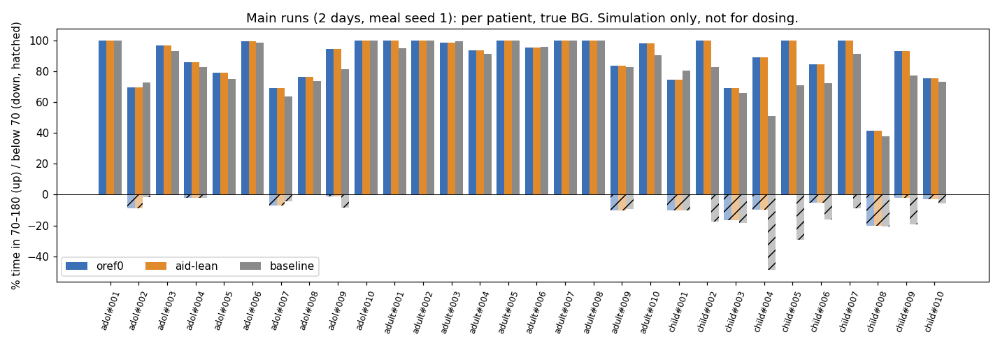
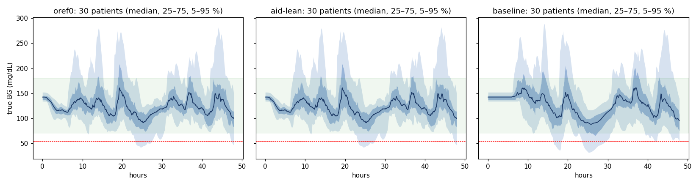
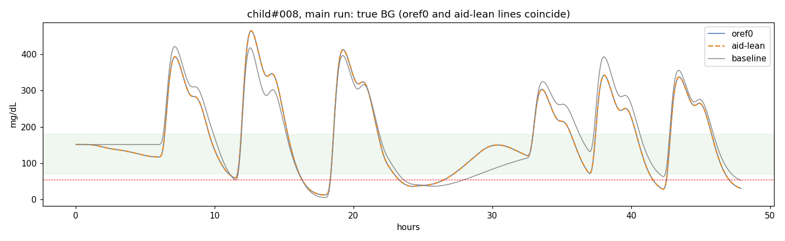
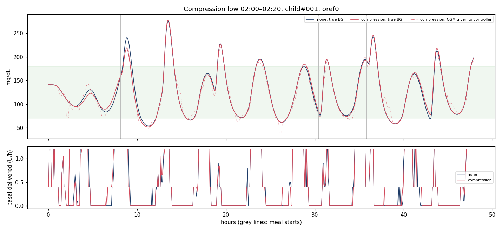
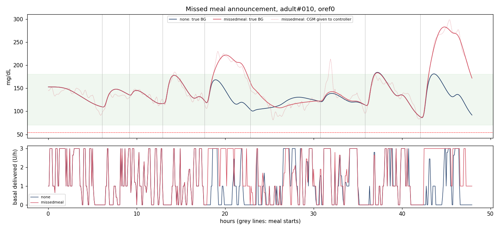
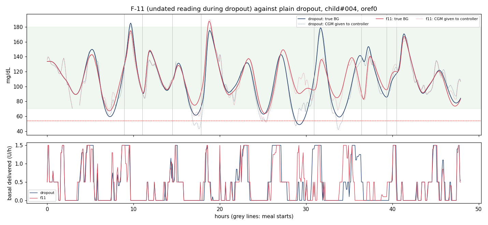
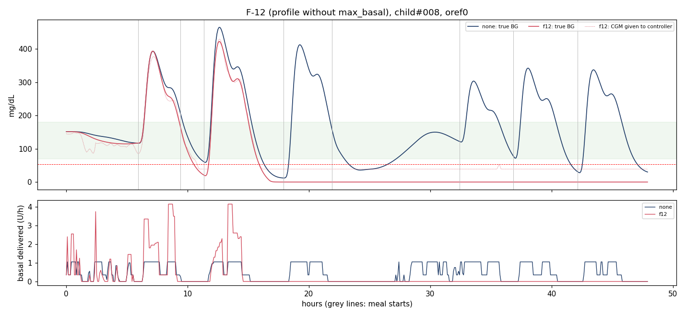

# Virtual patients: closed-loop results

**Research artifact. Nothing here says that oref0 or aid-lean is safe for people, and
nothing here may be used to dose insulin.** The patients are simglucose's, an open
reimplementation of the 2008 UVA/Padova simulator, which is not FDA-accepted evidence;
the profiles are derived from the simulator's parameters, not set by a clinician.

Harness and method: `sim/README.md`. Numbers: `sim/report.py` (reads `sim/out/runs/`,
writes `sim/out/report.json` and the plots in `sim/out/plots/`). Run data
(`sim/out/runs/`, 512 runs, about 1 GB) is not committed; `sim/out/progress.log` is.

## What ran

`sim/run_all.sh`, 18 November 2026 21:55:20 to 19 November 09:55:22 EET (12.0 h,
7 worker processes, git `5650f43`). 512 runs finished, 0 failed. At the 12-hour mark the
7 runs in progress were all 7-day aid-lean runs (item 4) and were **discarded** as the
plan says (logged in `progress.log`: child#009 and child#010 of meal seed 2, adolescent#001
to #005 of meal seed 3).

| item | runs | controllers | finished at |
|---|--:|---|---|
| 1. main: 30 patients, 2 days, meal seed 1 | 90 | oref0, aid-lean, baseline | 22:45 |
| 2. faults: dropout, compression, missed meal; 2 days | 180 | oref0, aid-lean | 01:22 |
| 3. findings in a closed loop: F-11, F-12; 2 days | 120 | oref0, aid-lean | 03:22 |
| 4. 7 days, meal seed 1 | 60 | oref0, aid-lean | |
| 4. 7 days, meal seed 2 | 58 | oref0 (30), aid-lean (28) | |
| 4. 7 days, meal seed 3 | 4 | oref0 (adolescent#001–#004) | until 09:55 |

Time per simulated day, 7 runs in parallel: aid-lean 363 s (2-day runs) and 388 s
(7-day runs), oref0 9–10 s, baseline 3 s. Items 1–3 took 5 h 27 min (estimated: 5 h).

Groups: 10 children, 10 adolescents, 10 adults. "Baseline" is simglucose's own
basal-bolus controller (no loop). All glucose metrics are on the **true** (simulated
plasma) glucose, every 5 minutes; a group value is the mean of the per-run values.
SMB is off and autosens ratio 1 in every run (`sim/README.md`, Profiles).

## oref0 and aid-lean: identical at every step

In every aid-lean run the decision applied to the pump is aid-lean's (Lean: IOB with
`LeanAID.Iob.generate`, the decision with `LeanAID.determineBasal`), and oref0 (Node)
runs on exactly the same input at the same step. Over all 238 aid-lean runs (main,
faults, findings, 7-day):

- **220,608 of 220,608 decisions identical** (the JSON output compared byte for byte:
  rate, duration, reason text, predictions);
- **220,608 of 220,608 IOB arrays identical** (every field aid-lean prints, for all 48
  points, and `lastBolusTime`, `lastTemp`);
- no first difference to report, and no controller error in either program.

And the two arms as wholes: each of the 238 aid-lean runs was compared with the oref0
run of the same patient, meal seed and fault, step by step. **All 238 pairs are
identical** in true glucose, CGM, insulin delivered and the decision applied (220,608
steps). So every glucose number below is the same for oref0 and aid-lean, and the
tables list both only to show that.

What this does not cover: the meal data (COB) in the aid-lean arm is computed by
oref0's lib/meal (JavaScript), not Lean; SMB was off, so the microbolus code ran only
to decide not to bolus; the input class of F-17 (carbs dated after the decision time),
on which the two differ, does not arise in a correct harness.

## Results





**Main runs: 2 days, meal seed 1, no fault**

| controller | group | runs | TIR 70–180 | <70 | <54 | >180 | >250 | mean | CV | U/day | lowest BG | runs with any <54 |
|---|---|--:|--:|--:|--:|--:|--:|--:|--:|--:|--:|--:|
| oref0 | child | 10 | 82.6 % | 6.70 % | 3.11 % | 10.7 % | 4.17 % | 124.1 | 32.4 % | 21.8 | 12 | 5 |
| oref0 | adolescent | 10 | 87.0 % | 1.88 % | 0.83 % | 11.1 % | 1.35 % | 132.1 | 24.6 % | 42.7 | 41 | 3 |
| oref0 | adult | 10 | 96.8 % | 1.02 % | 0.83 % | 2.1 % | 0.00 % | 125.8 | 17.4 % | 57.0 | 35 | 1 |
| oref0 | **all** | 30 | 88.8 % | 3.20 % | 1.59 % | 8.0 % | 1.84 % | 127.3 | 24.8 % | 40.5 | 12 | 9 |
| aid-lean | child | 10 | 82.6 % | 6.70 % | 3.11 % | 10.7 % | 4.17 % | 124.1 | 32.4 % | 21.8 | 12 | 5 |
| aid-lean | adolescent | 10 | 87.0 % | 1.88 % | 0.83 % | 11.1 % | 1.35 % | 132.1 | 24.6 % | 42.7 | 41 | 3 |
| aid-lean | adult | 10 | 96.8 % | 1.02 % | 0.83 % | 2.1 % | 0.00 % | 125.8 | 17.4 % | 57.0 | 35 | 1 |
| aid-lean | **all** | 30 | 88.8 % | 3.20 % | 1.59 % | 8.0 % | 1.84 % | 127.3 | 24.8 % | 40.5 | 12 | 9 |
| baseline | child | 10 | 70.2 % | 19.53 % | 8.85 % | 10.3 % | 4.17 % | 116.4 | 39.3 % | 23.1 | 5 | 8 |
| baseline | adolescent | 10 | 83.9 % | 1.68 % | 0.00 % | 14.4 % | 1.68 % | 140.0 | 24.5 % | 41.0 | 56 | 0 |
| baseline | adult | 10 | 95.4 % | 0.94 % | 0.66 % | 3.6 % | 0.00 % | 130.7 | 18.4 % | 55.5 | 46 | 1 |
| baseline | **all** | 30 | 83.2 % | 7.38 % | 3.17 % | 9.4 % | 1.95 % | 129.0 | 27.4 % | 39.9 | 5 | 9 |

oref0 and aid-lean (identical) against the baseline: higher time in range (88.8 % against
83.2 %) and less time below 70 mg/dL (3.2 % against 7.4 %), most clearly for children
(6.7 % against 19.5 %), for about the same insulin (40.5 against 39.9 U/day).

**7 days, meal seed 1**

| controller | group | runs | TIR 70–180 | <70 | <54 | >180 | >250 | mean | CV | U/day | lowest BG | runs with any <54 |
|---|---|--:|--:|--:|--:|--:|--:|--:|--:|--:|--:|--:|
| oref0 | child | 10 | 77.4 % | 15.38 % | 11.75 % | 7.3 % | 2.27 % | 107.2 | 47.7 % | 20.6 | 0 | 8 |
| oref0 | adolescent | 10 | 85.4 % | 3.49 % | 1.51 % | 11.1 % | 1.30 % | 129.5 | 26.5 % | 42.1 | 33 | 3 |
| oref0 | adult | 10 | 95.7 % | 2.40 % | 1.23 % | 1.9 % | 0.00 % | 122.7 | 19.2 % | 55.2 | 19 | 1 |
| oref0 | **all** | 30 | 86.2 % | 7.09 % | 4.83 % | 6.7 % | 1.19 % | 119.8 | 31.1 % | 39.3 | 0 | 12 |
| aid-lean | child | 10 | 77.4 % | 15.38 % | 11.75 % | 7.3 % | 2.27 % | 107.2 | 47.7 % | 20.6 | 0 | 8 |
| aid-lean | adolescent | 10 | 85.4 % | 3.49 % | 1.51 % | 11.1 % | 1.30 % | 129.5 | 26.5 % | 42.1 | 33 | 3 |
| aid-lean | adult | 10 | 95.7 % | 2.40 % | 1.23 % | 1.9 % | 0.00 % | 122.7 | 19.2 % | 55.2 | 19 | 1 |
| aid-lean | **all** | 30 | 86.2 % | 7.09 % | 4.83 % | 6.7 % | 1.19 % | 119.8 | 31.1 % | 39.3 | 0 | 12 |

**7 days, meal seed 2 (aid-lean: child#009 and child#010 discarded at the deadline)**

| controller | group | runs | TIR 70–180 | <70 | <54 | >180 | >250 | mean | CV | U/day | lowest BG | runs with any <54 |
|---|---|--:|--:|--:|--:|--:|--:|--:|--:|--:|--:|--:|
| oref0 | child | 10 | 79.1 % | 12.31 % | 7.49 % | 8.6 % | 2.71 % | 114.0 | 40.0 % | 20.8 | 0 | 7 |
| oref0 | adolescent | 10 | 85.0 % | 3.53 % | 1.36 % | 11.5 % | 1.20 % | 129.8 | 26.7 % | 42.5 | 18 | 3 |
| oref0 | adult | 10 | 95.5 % | 2.23 % | 0.60 % | 2.3 % | 0.00 % | 122.2 | 19.3 % | 54.9 | 15 | 2 |
| oref0 | **all** | 30 | 86.5 % | 6.02 % | 3.15 % | 7.5 % | 1.30 % | 122.0 | 28.6 % | 39.4 | 0 | 12 |
| aid-lean | child | 8 | 78.0 % | 14.24 % | 9.31 % | 7.8 % | 2.46 % | 111.8 | 41.1 % | 21.4 | 0 | 6 |
| aid-lean | adolescent | 10 | 85.0 % | 3.53 % | 1.36 % | 11.5 % | 1.20 % | 129.8 | 26.7 % | 42.5 | 18 | 3 |
| aid-lean | adult | 10 | 95.5 % | 2.23 % | 0.60 % | 2.3 % | 0.00 % | 122.2 | 19.3 % | 54.9 | 15 | 2 |
| aid-lean | **all** | 28 | 86.7 % | 6.12 % | 3.36 % | 7.1 % | 1.13 % | 122.0 | 28.1 % | 40.9 | 0 | 11 |

**7 days, meal seed 3 (only the 4 oref0 runs that finished)**

| controller | group | runs | TIR 70–180 | <70 | <54 | >180 | >250 | mean | CV | U/day | lowest BG | runs with any <54 |
|---|---|--:|--:|--:|--:|--:|--:|--:|--:|--:|--:|--:|
| oref0 | adolescent | 4 | 85.3 % | 4.70 % | 2.28 % | 10.0 % | 0.25 % | 127.2 | 24.1 % | 42.0 | 16 | 1 |
| oref0 | **all** | 4 | 85.3 % | 4.70 % | 2.28 % | 10.0 % | 0.25 % | 127.2 | 24.1 % | 42.0 | 16 | 1 |

**The 7-day numbers for children are dominated by a simulator artefact.** In 3 runs per
arm the simulated glucose reaches 0 and never comes back, even through later meals:
child#003 (7 days, seed 1) from hour 98, child#008 (7 days, seed 1) from hour 71,
child#008 (7 days, seed 2) from hour 95, and child#008 in the F-12 run from hour 17.
That is not physiology but the model leaving its valid range. The CGM reads its floor
(39–40 mg/dL) and oref0 keeps a zero temp. Without these runs, 7 days, oref0: seed 1 (28 runs)
TIR 90.2 %, below 54 1.2 % (children 0.8 %); seed 2 (29 runs) TIR 88.8 %, below 54
1.4 % (children 2.3 %).

**Where the lows come from.** In the oref0 runs without faults (2 and 7 days), 5,203 of
the 5,282 five-minute steps with true glucose below 54 mg/dL had **no basal insulin
delivered** (zero temp), and in 4,148 of them oref0's IOB was negative. The lows follow
meal boluses (carbs / CR, from simglucose's parameters), median 6.4 h later. The baseline
controller, which never suspends, has more time below 54 mg/dL among the children (8.9 %
against 3.1 %), though not in every child (child#008: 13.9 % against 14.9 %). The
plain reading: for several children the derived profile (CR, ISF, DIA 5 h) does not match
the simulated insulin action, and suspending is not enough to prevent the low. One
counterexample where the loop added to it: child#008 (below) reached 460 mg/dL after an
86 g meal, oref0 ran its maximum temp (1.05 U/h, 3 × basal) for about an hour, suspended
at 15:15 at 181 mg/dL, and glucose fell to 12 mg/dL at 17:55; the baseline reached
5 mg/dL in the same patient in the same hours.



## Safety monitor: every violation

The monitor (`sim/monitor.py`) checks R1, R2, R4, R6, R8–R12 and "microbolus while SMB
is off" on every decision of both arms (`docs/REQUIREMENTS.md`). Over all 512 runs:

| rule | runs (oref0 arm / aid-lean arm) | decisions (oref0 / aid-lean) | where |
|---|---|--:|---|
| R1 rate > maxSafeBasal (configured `max_basal`) | 30 / 30 | 1,064 / 1,064 | F-12 runs only |
| R8 low and not rising, no zero temp | 9 / 8 | 16 / 13 | dropout (7 / 7), F-11 (5 / 5), F-12 (1 / 1), 7-day child#009 seed 2 (3 / –, aid-lean twin discarded) |
| R2, R4, R6, R9, R10, R11, R12, SMB | 0 | 0 | |

**R1** is F-12 by construction: without `max_basal` oref0 applies no clamp; the issued
rate reached up to 9.8 × the configured `max_basal` (adolescent#008: 16.1 U/h against
1.65, day 1 at 16:45).

**R8: new finding F-18.** All 16 decisions are oref0's "CGM data is unchanged" branch
(determine-basal.js lines 177-185): `delta` exactly 0 and both average deltas within ±1
make oref0 treat the reading as a CGM error and leave the basal as it is, whatever the
glucose. 12 were the first reading after a 45-minute dropout (glucose-get-last.js then
has no earlier reading in its windows and returns all deltas 0), 4 were a genuinely flat
low CGM (e.g. child#009, day 6: 65, 65, 65 mg/dL with a 0.4 U/h temp running). Each
episode ended at the next reading that differed (5–15 minutes). **No theorem is
contradicted:** `low_glucose_suspend` assumes `dbPrelude` succeeds, and the prelude fails
on flat data (`cgmFlat`). The English text of R8 ("fresh, non-error reading") did not
say so; it does now (REQUIREMENTS R8, FINDINGS F-18). The monitor checks the stronger
statement on purpose.

## Faults and findings in a closed loop

**Faults and findings: all 30 patients, 2 days, meal seed 1 (oref0 = aid-lean in every run)**

| run | TIR | <70 | <54 | >180 | >250 | mean | CV | U/day | lowest BG | monitor violations (per arm) |
|---|--:|--:|--:|--:|--:|--:|--:|--:|--:|--:|
| none | 88.8 % | 3.20 % | 1.59 % | 8.0 % | 1.84 % | 127.3 | 24.8 % | 40.5 | 12 | 0 |
| dropout | 88.5 % | 3.40 % | 1.68 % | 8.1 % | 1.83 % | 127.7 | 24.9 % | 40.4 | 12 | 7 |
| compression | 88.8 % | 3.26 % | 1.66 % | 8.0 % | 1.83 % | 127.4 | 24.8 % | 40.4 | 13 | 0 |
| missedmeal | 81.2 % | 1.26 % | 0.39 % | 17.5 % | 7.30 % | 146.7 | 37.9 % | 36.7 | 37 | 0 |
| f11 | 88.9 % | 3.06 % | 1.61 % | 8.1 % | 1.82 % | 127.9 | 24.6 % | 40.3 | 11 | 5 |
| f12 | 86.0 % | 8.29 % | 4.80 % | 5.7 % | 1.08 % | 117.1 | 31.3 % | 42.4 | 0 | 1065 |

**Change against the no-fault run of the same patient (mean over 30 patients)**

| fault | ΔTIR (pp) | Δ<70 (pp) | Δ<54 (pp) | Δmean BG | ΔU/day | Δlowest BG (mean; worst) | patients with more time <70 |
|---|--:|--:|--:|--:|--:|--:|--:|
| dropout | -0.3 | +0.20 | +0.09 | +0.4 | -0.08 | -0.2; -6.0 | 3 / 30 |
| compression | -0.1 | +0.06 | +0.06 | +0.0 | -0.03 | -0.1; -2.2 | 5 / 30 |
| missedmeal | -7.6 | -1.94 | -1.20 | +19.4 | -3.75 | +7.3; -17.4 | 2 / 30 |
| f11 | +0.1 | -0.14 | +0.02 | +0.5 | -0.13 | +0.5; -3.8 | 3 / 30 |
| f12 | -2.8 | +5.09 | +3.21 | -10.2 | +1.89 | -11.9; -32.6 | 18 / 30 |

(The "lowest BG" column is the lowest true glucose in any run of the group; the Δlowest
BG column is the mean and the worst per-patient change.)

- **Sensor dropout** (no readings 03:00–03:45 and 15:00–15:45): almost no effect on
  average. During the gap oref0 sees stale data and leaves the pump as it is (a zero temp
  that expires is not renewed); the first reading after the gap falls into F-18 (7 R8
  violations per arm).
- **Compression low** (CGM 40 mg/dL too low for 20 minutes at 02:00): oref0 sets a zero
  temp on the false low; when the reading jumps back (child#001: 71 → 107 mg/dL at 02:20)
  it reads a steep rise and sets its maximum temp for one 5-minute step, then zero again.
  The effect on glucose is small (largest drop in the lowest glucose: 2.2 mg/dL).

  

- **Missed meal announcement** (the largest meal of each day eaten without carbs or
  bolus): TIR −7.6 points, mean glucose +19 mg/dL, peaks up to 114 mg/dL higher (mean
  change of the maximum). oref0's temps make up about half of the missing insulin
  (over 2 days: +8.7 U basal against −16.2 U bolus, mean per patient), later than a bolus
  would. Less time below 70, because less insulin.

  

- **F-11** (during the dropout, the last reading keeps arriving without a date): **no
  harm in this scenario.** The undated copy has delta 0, so oref0's flat-CGM check
  catches it before the missing staleness check matters. Compared with plain dropout:
  mean glucose +0.2 mg/dL, insulin −0.05 U/day; the trajectories diverge after the first
  different decision, in both directions. The dangerous F-11 input (an undated reading
  with non-zero deltas, FINDINGS F-11) did not arise here.

  

- **F-12** (profile without `max_basal`): **harmful.** Temps up to 9.8 × the intended
  maximum after meals; +1.9 U/day insulin, mean glucose −10 mg/dL, time below 54 mg/dL
  4.8 % against 1.6 %, 18 of 30 patients more time below 70, the lowest glucose down by
  up to 33 mg/dL. Identical in both arms: `aid-lean` without `--safe` reproduces oref0;
  `aid-lean --safe` would refuse this input (FINDINGS F-12), which the harness did not
  test.

  

## F-24 (QUIRK Q6): oref0 against oref0 with the fix

`sim/q6_runs.py`, 20 November 2026, git branch `q6-split-timespan`, on Linux with
Python 3.14.4, simglucose 0.2.11, numpy 2.5.5, pandas 3.1.1, scipy 1.18.1 and
setuptools 80.10.2 (a new `.venv`; `sim/requirements.txt` lists the macOS set of the M11
runs). With these versions, the main run of adult#001 (oref0, flat schedule, seed 1)
reproduces the committed summary: the glucose metrics agree within 2 × 10⁻⁸ (mean
glucose within 10⁻⁹) and insulin exactly. 360 runs, each with all 576 steps. Report: `sim/q6_report.py` →
`sim/out/q6-report.json`.

Setup: 30 patients, meal seeds 1 to 3, 2 days, no fault, SMB off, as in the main runs.
Two basal schedules: `flat`, as in the M11 runs, and `steps`: 0.9, 1.1, 1.0, 0.95, 1.05
and 1.0 times the steady-state basal from 00:00, 03:00, 07:00, 12:00, 17:00 and 21:00. The
patient's insulin need stays constant, so `steps` is equally wrong for both arms. The
controller's `current_basal` follows the schedule at the simulated time (the pump does
too). Q6 can drop a piece of a temp that crosses a schedule entry, and midnight is an
entry even in `flat` (probe case H).

Open loop: in each oref0 run, oref0 with the fix (`sim/q6fix.js`) ran on the same input.
An IOB difference is |IOB now| differing by more than 0.0005 U. An action difference is
a different temp rate, duration or microbolus.

| schedule | group | runs | steps | steps with an IOB difference | largest | steps with another action | rate, fixed − oref0 |
|---|---|--:|--:|--:|--:|--:|---|
| steps | child | 30 | 17,280 | 87 (0.50 %, 2 runs) | 0.099 U | 7 (0.04 %, 2 runs) | mean +0.10, 0.00 to +0.15 U/h (5) |
| steps | adolescent | 30 | 17,280 | 257 (1.49 %, 6 runs) | 0.345 U | 36 (0.21 %, 5 runs) | mean +0.21, +0.05 to +0.55 U/h (25) |
| steps | adult | 30 | 17,280 | 466 (2.70 %, 5 runs) | 0.641 U | 119 (0.69 %, 5 runs) | mean +0.19, −0.45 to +1.15 U/h (84) |
| steps | all | 90 | 51,840 | 810 (1.56 %, 13 runs) | 0.641 U | 162 (0.31 %, 12 runs) | mean +0.19, −0.45 to +1.15 U/h (114) |
| flat | all | 90 | 51,840 | 0 | | 0 | |

In all 810 steps with a difference, the fixed IOB is lower than oref0's: the dropped
pieces are pieces of zero or low temps, so oref0 counts too much insulin on board. On
average the fixed oref0 then sets a higher temp. The rate column covers the 114 steps where
both arms set a temp. The table does not count differences in the 48-point IOB array
beyond now, in the forecasts or in the reason text. Counting those too, oref0 and the
fixed version differ in 7,237 steps of 90 stepped runs, and the suggestion (forecasts,
reason or action) in 1,250 steps of 84 runs. In the flat runs, every run differs in the
zero-temp IOB (`iobWithZeroTemp`) at 20:30-20:55: `lib/iob` imagines a 240-minute zero
temp starting one minute after now for the zero-temp forecast, and from these times it crosses midnight, where
Q6 cuts it. That is 1,080 steps; the suggestion differs in 69 of them, in 39 runs, and the
action in none. No delivered temp in the flat runs lost a piece at midnight.

Closed loop: the fixed oref0 doses. Differences fixed − oref0, paired by patient and
meal seed, schedule `steps`: mean [smallest, largest]. Times are in percentage points,
glucose in mg/dL, insulin in U/day.

| group | pairs | TIR 70–180 | <70 | <54 | >180 | mean BG | lowest BG | insulin |
|---|--:|--:|--:|--:|--:|--:|--:|--:|
| child | 30 | +0.00 [+0.00, +0.00] | +0.00 [+0.00, +0.00] | +0.00 [+0.00, +0.00] | +0.00 [+0.00, +0.00] | −0.01 [−0.19, +0.00] | +0.00 [+0.00, +0.00] | +0.00 [−0.01, +0.02] |
| adolescent | 30 | +0.02 [+0.00, +0.35] | +0.00 [+0.00, +0.00] | +0.00 [+0.00, +0.00] | −0.02 [−0.35, +0.00] | −0.02 [−0.24, +0.00] | +0.01 [−0.23, +0.51] | +0.00 [+0.00, +0.04] |
| adult | 30 | +0.02 [+0.00, +0.35] | +0.00 [+0.00, +0.00] | +0.00 [+0.00, +0.00] | −0.02 [−0.35, +0.00] | −0.03 [−0.54, +0.01] | −0.01 [−0.62, +0.31] | +0.00 [−0.03, +0.09] |
| all | 90 | +0.01 [+0.00, +0.35] | +0.00 [+0.00, +0.00] | +0.00 [+0.00, +0.00] | −0.01 [−0.35, +0.00] | −0.02 [−0.54, +0.01] | −0.00 [−0.62, +0.51] | +0.00 [−0.03, +0.09] |

12 of 90 pairs change at all. One step is 0.17 percentage points of a 2-day run. The
largest change in a glucose band is 2 steps, from above 180 to the range 70–180. Time
below 70 and below 54 does not change in any pair. Mean glucose changes by at most
0.54 mg/dL, the lowest glucose by at most 0.62 mg/dL, and insulin by at most 0.094 U/day.
Insulin rises in 8 pairs and falls in 4. With the flat schedule, delivered insulin and
glucose are identical in all 90 pairs. FINDINGS F-24 rates the
dosing severity low from this. Limits of these runs, in addition to those below: one
synthetic stepped schedule, 2 days, SMB off, and no manual temps. A long manual high temp
(probe case F) loses insulin in the other direction and does not occur here.

## Limits

- simglucose 0.2.11 is an open reimplementation of the 2008 UVA/Padova simulator, not
  FDA-accepted evidence, and its glucose can leave the physiological range (the runs that
  stay at 0 mg/dL above).
- The profiles are derived from the simulator's parameters (basal from steady state, CR
  and ISF from Quest.csv, `max_basal` = 3 × basal, DIA 5 h), not tuned by a clinician.
  The meal bolus is carbs / CR, with no correction. Bad results for some children say as
  much about these profiles as about the algorithm.
- 30 patients; 2 days for the main, fault and finding runs (one meal seed); 7 days for
  two meal seeds only (and 4 runs of a third). One CGM noise seed per run. No exercise,
  no sensitivity changes, no pump or communication faults other than the CGM faults
  above. SMB, autosens, temp targets and autotune were off.
- The aid-lean arm uses JavaScript for COB (lib/meal).
- The monitor checks single decisions against requirements, not outcomes; the glucose
  outcome is reported, not judged.
- Nothing here says that the algorithm is safe for people.

## Reproduce

```bash
.venv/bin/python sim/harness.py --patient 'child#008' --controller aid-lean --days 2 --fault f12
nohup caffeinate -i sim/run_all.sh > sim/out/run_all.log 2>&1 &   # the 12-hour job list
.venv/bin/python sim/report.py                                    # report.json, plots (2 min)
```
